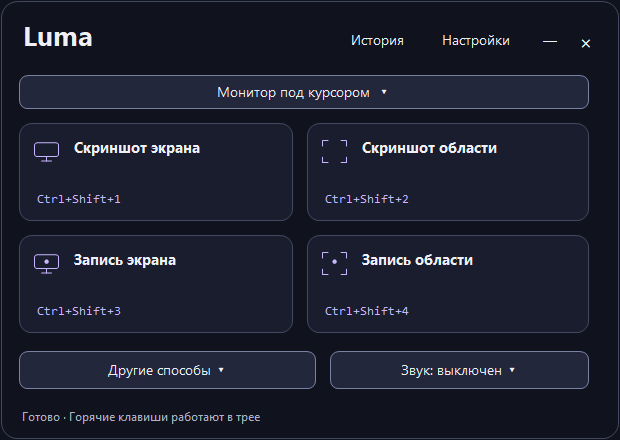

# Luma 2.5.0 — скриншоты и запись экрана для Windows

[**Скачать Luma для Windows x64**](https://github.com/Mintruslan/Luma/releases/latest/download/Luma-Windows-x64.zip) · [Все версии](https://github.com/Mintruslan/Luma/releases)

Четыре действия с горячими клавишами: снимок экрана, снимок области, запись экрана и запись области. Работает в трее; поддерживает несколько мониторов, пометки на снимках и рисование во время записи.




Распакуйте весь `Luma-Windows-x64.zip` и запустите `Luma.exe`. Оставьте рядом `ffmpeg.exe` и `ffprobe.exe`: второй нужен для превью, обрезки и обработки видео. Установка .NET и права администратора не нужны. Windows 10 версии 2004 и новее, Windows 11, x64. Сборка не подписана.


## Обновление 2.5.0 — небольшое главное окно

- Главное окно 620×440 при 100% масштабе: четыре действия, видимые горячие клавиши и один список экрана для захвата.
- Список сразу предлагает монитор под курсором, все мониторы и каждый подключённый монитор; отдельного выбора режима и номера нет.
- История и настройки открываются сверху. На дополнительных страницах есть «Назад»; Esc возвращает к захвату с прежними размером и положением окна.
- Звук следующей записи настраивается из меню под кнопками записи. Текущее состояние видно до запуска; выбор устройств и качества открывает соответствующую страницу настроек.
- Пустой блок последнего результата скрыт. После захвата появляется строка с миниатюрой, именем файла, редактированием и копированием; высота главного окна становится 520.
- Боковое меню, правая колонка и декоративные уголки карточек убраны.
- Отдельного компактного пульта больше нет. Ctrl+Alt+5 открывает главное окно; панель текущей записи со стопом, паузой и рисованием сохранена.

## Обновление 2.4.0 — надёжность и удобство

- PNG записывается через временный файл. Неудачная запись или занятый файл не повреждают прежний снимок; изменения остаются в редакторе.
- Повторное Ctrl+S обновляет сохранённый файл редактора; «Сохранить как…» позволяет выбрать отдельную копию.
- Миниатюра открывается одним щелчком. Перетаскивание начинается после движения мыши; таймер миниатюры приостанавливается на время редактирования.
- В истории доступна кнопка «Показать ещё», если файлов больше 80. Поиск работает по всей сохранённой истории.
- Длинный снимок останавливается, если окно прокрутки перекрыто или перемещено. Команды возврата прокрутки направляются только в исходное окно.
- Вкладки настроек поддерживают Home / End и не переключаются по положению курсора при работе с клавиатурой.
- Команды открытого редактора не превращаются в новый захват при потере фокуса. Уменьшена задержка подготовки записи и продолжения после паузы.
- Обрезка видео прокручивается при нехватке высоты; редактор и обрезка помещаются в рабочую область монитора.
- Отмена обработки дожидается завершения FFmpeg. При закрытии видеопросмотра останавливаются воспроизведение и звук. Ошибка открытия видео обрабатывается внутри приложения.
- Готовая запись появляется в истории до выбора другой папки: ошибка дополнительного копирования не скрывает исходный MP4.
- Дополнительная проверка: `Luma.exe --stability-test <папка>`.

## Обновление 2.3.0 — исправления глубокого аудита

Основной сценарий — работа в трее с глобальными горячими клавишами. В версии 2.5 отдельный пульт заменён небольшим главным окном. Во время записи отдельная панель предоставляет стоп, паузу, рисование и уровни звука.

- Редактор защищает несохранённые изменения: сохранить с выбором пути, отказаться или продолжить редактирование. Отмена до исходного состояния снимает предупреждение.
- Снимок только в буфере становится настоящим последним результатом: можно повторно скопировать, редактировать и сохранить, даже если содержимое системного буфера уже изменилось.
- Большой PNG открывается целиком. «Вписать», 100%, Ctrl+0 и Ctrl+1 переключают масштаб; прокрутка остаётся тёмной. Shift+колесо прокручивает по горизонтали.
- В небольшом окне обзор прокручивается без сжатия карточек. Выбор экрана и действия последнего результата остаются доступными в обзоре.
- История загружает небольшие превью в фоне, ограничивает кэш и отменяет устаревшие запросы. Метаданные показывают исходное разрешение. Enter / пробел открывают сфокусированное превью; контекстное меню доступно с клавиатуры.
- Активный буфер видео разрешает снимки и OCR. Вторую запись нужно запускать после выключения буфера; при конфликте есть подсказка. Экран и звук активного буфера фиксируются при его запуске.
- В обрезке видео можно просмотреть выбранный интервал внутри Luma, со звуком, паузой и перемоткой. Пробел — воспроизведение / пауза. «Оригинал ↗» открывает полный файл во внешнем плеере.
- На обзоре есть быстрые переключатели микрофона и звука компьютера, индикатор включённого микрофона и заметная подпись записи без звука. Режим под курсором показывает текущий монитор.
- Разделы настроек доступны видимыми вкладками, список клавиш разбит на группы; справка редактора раскрывается отдельно.

## Исправления 2.2.0

Тонкие тёмные полосы прокрутки в настройках, горячих клавишах, мониторах и истории. Рамки панелей остаются неподвижными при прокрутке. Пунктир фокуса заменён аккуратной сплошной обводкой при навигации с клавиатуры. Поиск, фильтр и обновление истории выровнены по высоте. Старые всплывающие подсказки закрываются при смене страницы.

## Интерфейс 2.1

Обновлён дизайн существующего приложения: непрозрачные чернильные поверхности, фиолетовый выбор, рамка захвата и подписи размеров/клавиш моноширинным шрифтом. Общие цвета, размеры текста, отступы, скругления и состояния заданы в `DesignTokens.cs` и `Theme.cs`.

Пять страниц студии сохраняют прежние действия. Настройки и клавиши подстраиваются под ширину окна; история перестраивает столбцы и различает отсутствие файлов, отсутствие совпадений и недоступное превью. Недоступные действия последнего результата отключены до первого файла. Настройки применяются сразу.

Для выбора монитора на схеме используйте Tab, стрелки и Enter/Пробел. Селекторы поддерживают стрелки, F4 и Alt+↓. Переключатели работают по Пробелу. Сплошная тонкая рамка обозначает фокус с клавиатуры, фиолетовый акцент — выбранный режим. Анимаций переходов нет.

Главное окно — 620×440, с последним результатом — 620×520 при 100% масштабе. Настройки и история открываются в увеличенном окне с кнопкой «Назад». Фактическая проверка выполнена при 96 DPI; отдельно проверено масштабирование макета на 125/150/200%. Это не заменяет проверку переключения системного DPI на всех конфигурациях Windows.
## Мониторы

В блоке «Экран для захвата» на обзоре три режима, общие для PNG и MP4:

- **Выбор монитора** — экран из списка или схемы.
- **Все мониторы** — весь рабочий стол, включая экраны слева или выше основного. Промежутки между экранами могут быть чёрными.
- **Монитор под курсором** — экран под мышью в момент запуска действия. Он определяется до скрытия окна и задержки, и остаётся выбранным до конца снимка или записи.

Отдельного переключателя курсора больше нет. Старые настройки автоматически переводятся в соответствующий режим. Отключённый выбранный монитор требует нового выбора. При изменении конфигурации во время записи приложение завершает и сохраняет видео.

В настройках можно дополнительно включить отдельные файлы для каждого экрана при полном захвате в режиме «Все». Общий PNG/MP4 тоже сохраняется.

## Горячие клавиши

Все 16 сочетаний можно изменить или отключить. Занятые сочетания не заменяют прежние назначения.

| По умолчанию | Действие |
|---|---|
| Ctrl+Shift+1 | Снимок экрана |
| Ctrl+Shift+2 | Снимок области с редактором |
| Ctrl+Shift+3 | Запись экрана |
| Ctrl+Shift+4 | Выбор области для записи |
| Ctrl+Shift+5 | Стоп / отмена отсчёта / выключение буфера |
| Ctrl+Shift+6 | Рисование во время записи |
| Ctrl+Shift+7 | Пауза / продолжить |
| Ctrl+Shift+8 | Повтор последней области |
| Ctrl+Shift+9 | Распознать текст из области |
| Ctrl+Alt+1 | Снимок отдельного окна |
| Ctrl+Alt+2 | Запись отдельного окна |
| Ctrl+Alt+3 | Длинный снимок с прокруткой |
| Ctrl+Alt+4 | Закрепить последний PNG поверх окон |
| Ctrl+Alt+5 | Открыть Luma |
| Ctrl+Alt+6 | Включить / выключить буфер видео |
| Ctrl+Alt+7 | Сохранить последние секунды |

Поддерживаются Ctrl, Alt, Shift с основной клавишей, отдельные F1–F11, Print Screen и Pause. Win, F12 и Esc не назначаются. Esc отменяет диалоги и область; во время рисования возвращает управление приложениям, сохраняя рисунки. Основные действия доступны в окне, дополнительные — в трее и сочетаниями.

Крестик сворачивает Luma в трей. Полный выход — в меню трея; текущая запись сначала сохраняется. Повторный запуск открывает работающий экземпляр. Отдельного компактного пульта нет: основные действия доступны в небольшом главном окне. При записи появляется панель управления с паузой, стопом и рисованием.

## Снимки и редактор

Рамка изменяется за восемь маркеров; F1 перемещает её. F2–F7: перо, линия, стрелка, прямоугольник, эллипс и текст. F8 выбирает отдельную пометку для перемещения, удаления и изменения цвета/толщины. Двойной щелчок по тексту в этом режиме позволяет его изменить. F9 замазывает область непрозрачным чёрным, F10 размывает, F11 включает маркер. Основные инструменты подписаны; нумерация шагов и остальные инструменты доступны в меню «Ещё».

Ctrl+Z / Ctrl+Y — отмена / повтор; Delete удаляет выбранный объект, Ctrl+Delete очищает рисунки. Непрозрачная заливка полностью скрывает исходные пиксели; перекрывающее размытие не восстанавливает замазанные данные.

- **Копировать / Ctrl+C** — буфер, без файла.
- **Сохранить / Ctrl+S / Enter** — PNG; при включённой настройке открывается выбор пути.
- **Сохранить как… / Ctrl+Shift+S** — выбор папки и имени.
- **Текст** — локальное распознавание и копирование текста.
- **Закрепить** — плавающее окно поверх приложений; можно менять размер, положение и прозрачность.

Миниатюра после снимка позволяет копировать, править, закреплять или перетаскивать его в чат/приложение, принимающее файлы. Для снимка только в буфере временный PNG создаётся лишь при перетаскивании. Миниатюра закрывается примерно через восемь секунд и скрывается перед следующим захватом.

История хранит до 200 существующих файлов, содержит поиск, фильтр PNG/MP4, превью, копирование и перетаскивание. PNG снова открывается в редакторе с масштабированием и обрезкой; MP4 — в обрезке или системном проигрывателе. Сохранённый PNG содержит объединённые пиксели: прежние пометки после закрытия редактора не хранятся отдельными объектами. Новые пометки при повторном открытии редактируются отдельно.

## Видео

MP4 / H.264, 30 или 60 кадров/с. Можно ограничить ширину до 1920/1280, включить курсор и трёхсекундный отсчёт. Аппаратное кодирование NVIDIA/Intel/AMD выбирается автоматически или вручную; при отказе драйвера приложение переходит на процессор.

Звук компьютера и микрофон включаются независимо; можно выбрать устройства. Пауза исключает ожидание из видео и таймера; продолжение сохраняется в тот же итоговый файл. Остановка работает и на паузе.

Ctrl+Shift+6 открывает рисунки, текст, фигуры и нумерацию. Esc возвращает ввод приложениям; рисунки остаются. «Скрыть» убирает панель, сохраняя рисование. Режим объяснения включает подсветку курсора, кликов и исчезновение пометок через 3/5/10 секунд. Панели исключаются из захвата средствами Windows, когда сеанс это поддерживает.

Обрезка задаёт начало и конец до сотых секунды и сохраняет отдельный файл со звуком, оставляя оригинал. Её можно предлагать после остановки либо открывать из истории. Отмена выбора пути для видео оставляет готовую запись в папке по умолчанию.

Запись ведётся во временные MKV, затем преобразуется в MP4. После сбоя следующий запуск пытается восстановить читаемые части из `.luma-recording-*`. При ошибке обработки исходные части остаются. Восстановление зависит от наличия записанных кадров и исправности диска.

Буфер последних секунд включается вручную в настройках, трее или Ctrl+Alt+6. Длительность: 15/30/60/120 секунд. Ctrl+Alt+7 сохраняет последние кадры и продолжает буферизацию. Пока он включён, другие виды захвата недоступны. Используются выбранные настройки экрана и звука; временные данные на диске удаляются при нормальном выключении.

## OCR и длинные снимки

OCR работает через Windows локально. Если нужного языка нет, установите компонент распознавания в настройках языков Windows. Результат можно исправить перед копированием.

Для прокрутки выделите содержимое без неподвижной шапки и полосы прокрутки. Luma делает до 40 шагов, совмещает кадры и открывает результат в редакторе. Esc или стоп отменяет захват; приложение отправляет обратную прокрутку к исходной позиции. Анимация, закреплённые элементы, нестандартная прокрутка и повторяющиеся узоры могут мешать склейке.

## Хранение и ограничения

Папка по умолчанию: `Изображения\Luma`. Настройки и история: `%LOCALAPPDATA%\Luma\settings.json` и `history.json`; ошибки — `errors.log`. Приложение не отправляет снимки и записи по сети.

Захват использует Windows GDI. Защищённое видео, UAC/экран входа и часть игр в эксклюзивном полноэкранном режиме могут не захватываться. Большие мониторы, 60 кадров/с и экспорт отдельных экранов требуют ресурсов. Запись окна захватывает его клиентскую область; результат зависит от способа отрисовки приложения.

## Сборка и проверка

Нужны Windows x64 и .NET SDK 10:

```powershell
powershell -NoProfile -ExecutionPolicy Bypass -File .\build.ps1 -SkipDownload -Test
```

Без `-SkipDownload` скрипт скачивает FFmpeg и проверяет SHA-256. Сборка автономная. Проверяются PNG/MP4, клавиши, редактор, отрисовка вкладок и восстановление окна. Дополнительная проверка `--feature-test` проверяет новые инструменты, историю, OCR, звук, паузу, обрезку, окна, буфер и фиксацию экрана под курсором. Тестовые файлы не включаются в ZIP. Проверки временно меняют буфер обмена и курсор и создают короткие локальные записи.

Исходники Luma — MIT. Лицензии компонентов перечислены в `THIRD-PARTY-NOTICES.md` и приложенных файлах.


## Обновление 2.2.0 — удобство и исправления

- На обзоре один выбор экрана и один блок последнего результата; на остальных страницах панель мониторов скрыта. Превью остаётся видимым при минимальном окне.
- «Другие способы захвата» содержит снимок окна, запись окна, повтор области, длинный снимок и распознавание текста.
- Настройки разделены на «Снимки», «Видео и звук», «Сохранение» и «Дополнительно». Устройство звука появляется при включении источника; кодирование и параметры пометок раскрываются отдельно.
- Горячие клавиши: «Записать сочетание» начинает ввод, Tab переключает фокус, Enter применяет, Esc отменяет. Изменения не теряются при навигации.
- Единый список экрана синхронизируется с настройками мониторов; недоступные команды отключены во время захвата.
- История предлагает сетку и список, группировку по дням, время, размеры и длительность видео. Основное действие — открыть превью, копирование рядом, остальные команды в «Ещё».
- На обзоре видно состояние звука следующей записи; на панели записи видны источники и уровни звука.
- Обрезка: маркеры начала и конца, время и длительность выбранного фрагмента, обновление кадра при перемещении начала. Стрелки меняют начало, Shift+стрелки — конец, Ctrl ускоряет шаг. Точный ввод секунд сохраняется.

Проверки новых сценариев: `Luma.exe --ux-test <папка>`. Диагностические режимы используют отдельные настройки и тестовую историю.

Все тёмные меню используют светлый текст и стрелки. Палитра показывает цвет отдельным образцом с рамкой; название чёрного цвета остаётся читаемым.
